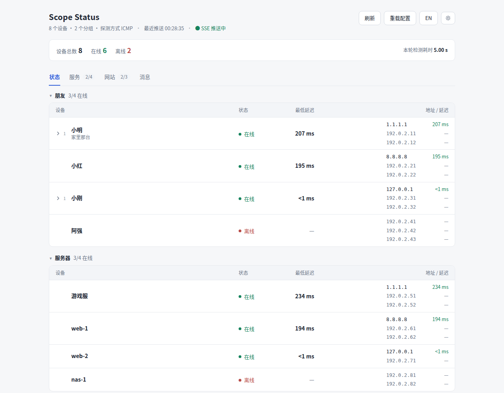
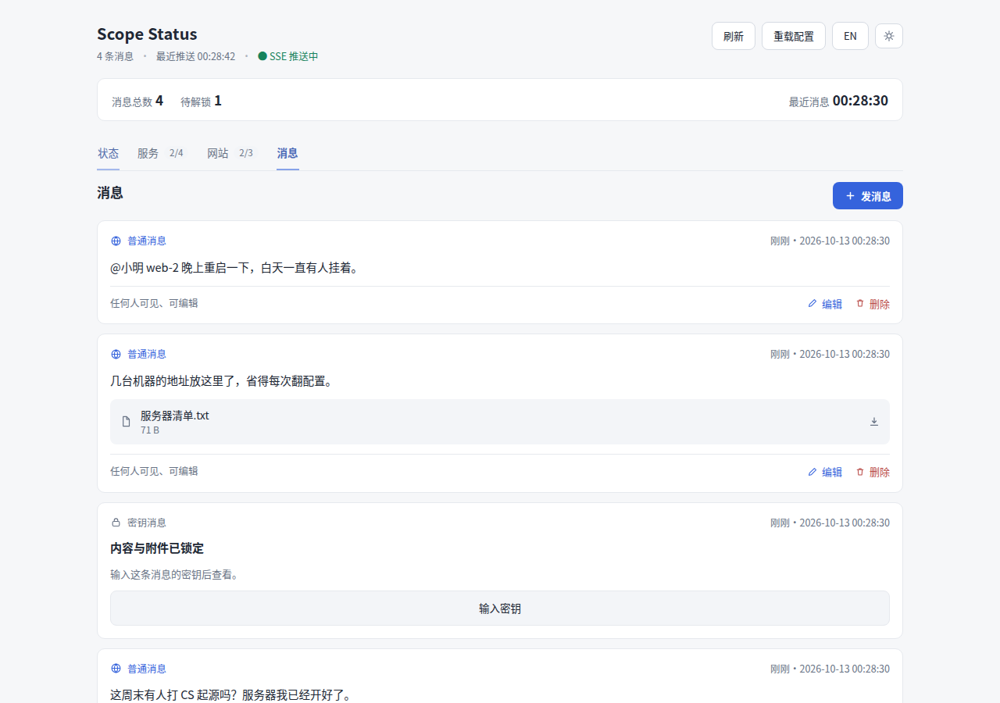
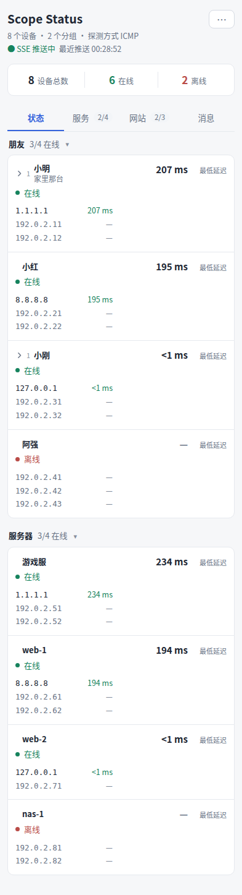

# Scope Status

内网连通状态看板：一行一个朋友 / 一台机器，实时显示 WireGuard 地址通不通；顺带看服务、网站和一个可传附件的消息面板。

交付物是一个**纯静态二进制**：前端产物 `go:embed` 进去，运行时只需要一个数据目录。



- 后端：Go 标准库 `net/http`，无 CGO、无框架、无 ORM。
- 前端：pnpm + Vite + Vue 3 + TypeScript，构建产物 `frontend/dist`。
- 配置与状态都在 `DATA_DIR`：手写的 `<DATA_DIR>/source.yaml` + 消息 `<DATA_DIR>/messages`，挂一个卷就是全部。
- 推送：只有 SSE，没有轮询；`GET /api/status` 读的是共享快照，恒定时间返回。
- 文案：中英双语，前后端各一张表，未知键原样显示（漏配一眼可见）。
- 依赖只有一个 `gopkg.in/yaml.v3`：`source.yaml` 是人手写的 YAML，标准库没有解析器；其余全走标准库。

## 功能

| 标签页 | 内容 |
| --- | --- |
| 状态 | 内网条目：一行一个，地址、最低延迟、连通性；按 `category` 分组、可折叠；点一行展开 `properties` |
| 服务 | 游戏服 / 站点后端：按 `protocol`（`udp` / `tcp` / `a2s`）探测；`connect_cmd` 可复制 |
| 网站 | 链接：站点图标 + 名字可点开，显示 HTTP 状态与延迟 |
| 消息 | 普通消息（所有人可见）与口令消息（服务端验口令）；支持附件；按时间戳倒序 |

- 概况栏四个页面高度一致，切标签不抖；消息页显示「消息总数 / 待解锁 / 最近消息」。
- 浅色 / 深色主题、中英双语，都记在 `localStorage`；≤560px 走卡片式布局（顶栏收进 `⋯`）。
- SSE 断线自动重连；顶栏显示推送状态与「服务端每 Ns 推一次」。




更多截图（服务 / 网站 / 属性 / 深色 / 英文 / 手机端消息与发消息）在 [`docs/`](docs/)。

## 快速开始

依赖：Go 1.27、Node 26、pnpm 12、[just](https://github.com/casey/just)（不用 just 也可以，见下面的等价命令）。

```bash
just run                      # 构建前端 → 配置与数据都在 ./.data → 127.0.0.1:8080
```

等价的手工流程：

```bash
cd frontend && pnpm install && pnpm build && cd ..
DATA_DIR=$PWD/.data go run .          # 配置默认读 .data/source.yaml
```

`just --list` 是全部命令：

| 命令 | 作用 |
| --- | --- |
| `just build` | 构建前端，再交叉编译 `linux/amd64` + `linux/arm64` 到 `.dist/app-linux-*` |
| `just run` | 本机跑起来（数据与配置都在 `.data/`） |
| `just check` | 提交前跑一遍：`go vet` + `go test` + 前端 `pnpm typecheck` |
| `just test` | 全部测试（`go test ./... -count=1`） |
| `just run` / `just stop` | 本机起停（`DATA_DIR` / `PORT` 可用环境变量覆盖，默认 `./.data` + 8080） |
| `just fmt` / `just clean` | `go fmt` / 清构建产物与缓存 |

> justfile 就是模板那一份，不做本地适配：Go 与 pnpm 的缓存用你自己的默认位置。`$HOME` 只读的环境（容器、CI）在调用时自己带上 `GOPATH=... GOCACHE=... npm_config_cache=...` 即可。
>
> 覆盖率用 `go test ./... -count=1 -cover` 看。

## 配置：`source.yaml`

```bash
cp source.example.yaml .data/source.yaml     # 先抄一份示例，再改成自己的
```

配置路径写死成 `<DATA_DIR>/source.yaml`（容器里是 `/data/source.yaml`），没有环境变量能改它。里面通常有密码之类的敏感值，
所以整个数据目录不入库，入库的只有 `source.example.yaml` 这份示例。

顶层是 mapping，四块：`friends` / `services` / `links` / `categories`（`probe`、`title` 可选）。顶层直接写数组等价于 `friends`。

```yaml
title: Scope Status          # 不写就用内置的「Scope Status」

probe:
  method: icmp             # icmp（走系统 ping）| tcp | http
  timeout: 2               # 秒
  port: 80                 # 地址没写端口时用这个
  concurrency: 16          # 并发探测数
  count: 1                 # icmp 的 -c

categories:
  - id: friend
    label: 朋友
    order: 1

friends:
  - name: 小明
    note: 家里那台
    category: friend       # 不写就是 friend
    addresses: ["10.0.0.2", "10.0.1.2"]       # 数组，IP 或域名，可带 :端口
    properties:            # 「名称: 值」的映射，按书写顺序展示
      面板账号: example-pass

services:
  - name: CS 起源
    host: 10.0.0.9
    port: 27015
    protocol: a2s          # udp | tcp | a2s
    category: 服务器
    connect_cmd: connect 10.0.0.9:27015
    properties:
      版本: 1.6

links:
  - name: 面板
    url: https://panel.example.com/
    probe_url: https://panel.example.com/healthz   # 探测地址，不写就探 url
    expect_status: 200                             # 状态码等于它才算通
```

校验是严格的：字段类型不对、`name` 为空、地址不是 IP / 域名、`port` 越界、`protocol` 不认识……都会在启动（或点「重载配置」）时**明确报错**，不做兜底。想改配置不必重启：改完点顶栏的「重载配置」（`POST /api/reload`），写坏了会原样把 YAML 的报错显示出来，旧配置继续生效。

## 环境变量

| 变量 | 默认值 | 说明 |
| --- | --- | --- |
| `DATA_DIR` | `/data` | 数据目录：配置 `<DATA_DIR>/source.yaml` 与消息 `<DATA_DIR>/messages` |
| `TZ` | 系统默认 | 时区，影响日志时间戳与消息文件名 |
| `HOST` / `PORT` | `127.0.0.1` / `8080` | 监听地址与端口 |
| `READYZ_TOKEN` | 空 | 非空时 `/readyz` 必须带 `?token=` |
| `TRUSTED_PROXIES` | `127.0.0.1/32,::1/128` | 可信反代网段，决定真实客户端 IP 怎么取 |
| `STREAM_INTERVAL` | `5` | SSE 循环探测间隔（秒）；`0` 表示不起循环、只在请求时探 |
| `MAX_API_CONCURRENCY` | `128` | API（含 `/livez` `/readyz`）并发上限 |
| `MAX_STATIC_CONCURRENCY` | `64` | 静态文件并发上限 |
| `MAX_UPLOAD_BYTES` | `1073741824` | 单个附件上限（1 GiB） |
| `GOMEMLIMIT` | 由运行时读 | Go GC 阈值 |

任何一个环境变量写错（比如 `PORT=abc`）都是启动即失败，不猜。

## HTTP 接口

接口清单、请求 / 响应字段、SSE 帧格式都在 [`DESIGN.md`](DESIGN.md#3-接口)。常用的几个：

```bash
curl -s localhost:8080/api/health | jq            # 运行状态与计数
curl -s 'localhost:8080/api/status?force=1' | jq  # 立刻探一次
curl -sN localhost:8080/api/events                # SSE：messages / snapshot / hello
curl -sX POST localhost:8080/api/reload | jq .message
```

`/api/status` 不带参数时读的是后台循环维护的共享快照（恒定时间）；有 SSE 循环时在首帧探测完成前回 `204`，让前端等推送。服务端渲染的文案（探测详情、错误）跟随请求或 SSE 连接的 `Accept-Language`，响应头带 `Content-Language` 与 `Vary: Accept-Language`。

`/api/*` 的错误体统一是 `{"detail": "…"}`（前端只读 `detail`），方法不对回 `405` 并带准的 `Allow`；所有响应带
`X-Content-Type-Options: nosniff`、`Referrer-Policy: no-referrer`、`X-Frame-Options: DENY`。`/livez` 永远 200 且不记日志；
`/readyz` 校验口令（不对回 `401`）与数据目录 / 数据文件权限（不对回 `503`，细节只进后端日志）。

## 消息面板

盘上只有两样东西，一视同仁，不分消息类型：

```
$DATA_DIR/messages/message-yyyy-MM-dd-HH-mm-ss-ms(4)-随机6位.json   一条消息一个文件
$DATA_DIR/messages/files/<sha256>                                    附件池，按内容寻址
```

```json
{
  "kind": "public",
  "text": "正文",
  "updatedAt": 1791821096370,
  "attachments": [{ "sha256": "<64 hex>", "name": "服务器清单.txt", "size": 103 }],
  "isDeleted": false
}
```

- **创建时间只在文件名里**，是唯一真相来源；json 里没有 `id`。
- 口令消息多一个 `key` 字段；正文在盘上是**明文**，门禁完全在服务端：没验过口令的响应里除了 `id` 和 `createdAt` 什么都不给，附件也不暴露，下载附件同样要带口令。口令只活在浏览器内存里，刷新即失效。
- 附件上传是**裸文件流**（`PUT /api/messages/files?name=...`），不拼 multipart；边写边算 sha256，写完按内容改名，池子里已有同样内容就直接丢掉刚写的临时文件。单个文件上限 1 GiB。
- 删除是打 `isDeleted` 标志位（json 原地保留），随后扫描全部 `message*.json`，只回收**不再被任何未删除消息引用**的池内文件。孤儿附件（传了又没发）等下一次删除触发的清扫才会被收走。
- 读到不合规的 json（缺字段、类型不对、id 对不上文件名）一律 500 报错，不修复、不跳过。

## i18n

- 后端 `i18n/`、前端 `frontend/src/i18n/` 各一张中英对照表；键是点号分层的符号名。
- 业务层只抛「键 + 参数」，渲染成哪种语言由 HTTP 层按 `Accept-Language` 决定；前端界面文案走自己的表。
- **未知键原样返回键名**，没有回退：漏配在界面上一眼可见。
- 后端占位符是 `%d` / `%s`，前端是 `{name}`。

## 测试

只用标准库 `testing`，表格驱动 + `t.Run`；`internal/testenv` 造临时 `DATA_DIR` 与临时配置文件，测试不碰真实数据。每个修过的 bug 在对应包的 `regress_test.go` 里钉一条用例。

```bash
just test                              # go test ./... -count=1
go test ./... -count=1 -cover          # 逐包覆盖率
just check    # vet + test + 前端 vue-tsc
```

实测覆盖率（`go test ./... -count=1 -cover`）：

| 包 | 覆盖率 | 说明 |
| --- | --- | --- |
| `core` | 82.8% | 配置解析与校验、探测、消息标识与口令 |
| `store` | 73.6% | `source.yaml` 读取、消息与附件池读写 |
| `app` | 73.5% | 探测循环、快照、广播、消息用例 |
| `api` | 77.6% | 路由、SSE、消息接口、静态文件、探针 |
| `i18n` | 87.1% | 语言协商与文案表 |
| `httpx` | 55.1% | 响应小工具、客户端 IP、访问日志、安全头 |

`go test -race ./...` 也是干净的。

## 项目结构

```
main.go              入口：读环境变量 → 建应用容器 → 挂路由 → 监听（只做接线）
web.go               go:embed frontend/dist，把前端产物编进二进制
api/                 HTTP 层：路由、中间件、语言协商、SSE、探针、静态文件、消息接口
app/                 用例层：探测循环与快照、广播、消息用例、启动时的一次性工作
core/                纯逻辑：配置解析与校验、探测、消息标识与口令，不 import 上层
store/               盘上存储：source.yaml 读取、消息与附件池读写
httpx/               HTTP 小工具：JSON / 文本响应、客户端 IP、访问日志
i18n/                后端文案表与 T(lang, key, args…)
frontend/            前端工程（pnpm + Vite + Vue + TS），构建产物 frontend/dist
internal/testenv/    测试脚手架：临时 DATA_DIR、临时配置、现成的测试服务
docs/                截图与反代示例
k8s.scope-status.yaml  Pod + PVC + ConfigMap（podman kube play / systemd 模板）
scope-status.kube      systemd quadlet 模板
```

## 部署

```bash
just build                                    # .dist/app-linux-amd64 / arm64
docker build -t scope-status .               # 或 podman build
podman kube play k8s.scope-status.yaml         # ConfigMap 注环境变量，PVC 挂 /data
```

- 镜像分三个阶段：node 构建前端 → Go 交叉编译静态二进制 → alpine 运行时（只放那一个二进制 + curl/tzdata）。
- `k8s.scope-status.yaml` 里容器开 `readOnlyRootFilesystem` 并 `drop: ALL`，只有 `/data` 可写；`<DATA_DIR>/source.yaml` 需要自己放进卷里（`podman cp` 或宿主目录型 PV），里面有密码，别提交进公共仓库。
- 探针分两个：`/livez` 只看进程且不记日志；`/readyz` 查依赖（配置载入、数据目录可写）并记一条审计日志，`READYZ_TOKEN` 能挡住外部探测。
- 反代要看 SSE：[`docs/reverse-proxy.md`](docs/reverse-proxy.md) 给了 nginx / Caddy 的要点（核心是关掉响应缓冲）。
- 数据目录就是全部状态：`messages/` 下的消息与附件，删掉即重建。

## 从 Python 版迁移

这一版是照 [go-web-template](https://github.com/hiromuraki/go-web-template) 的约定重写的 Go + Vue 版本，旧的 Python / Starlette + 原生 JS 实现整份归档在 `.prototype/python/`（只作参考，不再维护）：

- 配置内容原样继续用（字段含义没变，只是挪到 `<DATA_DIR>/source.yaml`；个别地方更严格：类型不对就报错，不再隐式转换）。
- 消息目录从 `<source.yaml 所在目录>/data/messages` 变成 `<DATA_DIR>/messages`；旧数据也一起归档在 `.prototype/python/data/`。
- CLI 参数换成环境变量；`--stream-interval` → `STREAM_INTERVAL`。
- 静态资源不再从磁盘目录读，而是编进二进制。
